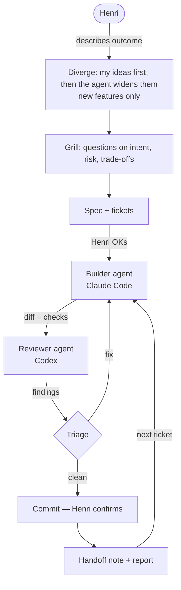

# How I build

I build software with two AI agents: one writes the code, the other reviews it, and I approve every
step that matters. This repo explains that workflow for coding and for design, and why each rule
exists. Most of the rules are here because something broke before they were in place.

I'm Henri, a business student in Berlin. I'm not a trained software engineer, so the workflow does
the job a senior colleague would: it asks the awkward questions up front, checks the work, and writes
down what we learned so the next session doesn't start from zero.

- [The core idea](#the-core-idea)
- [The coding loop](#the-coding-loop)
- [The design track](#the-design-track)
- [Memory: the knowledge engine](#memory-the-knowledge-engine)
- [Storage rules that came from breakage](#storage-rules-that-came-from-breakage)
- [What doesn't work yet](#what-doesnt-work-yet)
- [Local models](#local-models)
- [Examples](#examples)

## The core idea

Six rules carry the whole thing:

| Rule | Why |
|---|---|
| **The builder never reviews its own work.** | An agent checking its own diff shares the blind spots that produced it. A second model with fresh context catches different mistakes. |
| **Options before choices.** | Almost every step in this workflow narrows: questions, a spec, a review. Left alone, that means building the first idea that works. So a new feature starts with my own ideas written down, and only then does the agent widen them. In that order because AI suggestions shown first anchor you, and [a 2024 study](https://pmc.ncbi.nlm.nih.gov/articles/PMC11244532) found that AI help makes ideas more similar from person to person. |
| **Questions before code.** | A misunderstood goal is cheapest to fix before anything is built. The agent asks only about intent, risk and trade-offs, and looks up facts itself. |
| **One ticket at a time, one commit per ticket.** | Small diffs are reviewable. A commit only lands after a clean review, and I approve each commit and each push. |
| **Handoffs live in files, not chat.** | Usage limits run out mid-task. Whoever picks up next, the other agent or a new session, continues from a note in the ticket instead of a chat history it can't see. |
| **Search first, report after.** | Before solving something, the agent checks whether we solved it already. After solving something hard, it writes down what happened. Solved problems stay solved. |

## The coding loop

Every ticket runs through ten steps. A new feature or project gets a step 0 first; fixes don't.
Claude Code builds by default and Codex reviews. When Claude's usage is exhausted the roles swap.

| # | Step | What happens | Why |
|---|---|---|---|
| 0 | Diverge | I answer the six W-questions (why, who, what, where, when, how) in one line each and write down up to three ideas in about five minutes. Then the agent adds a variant of each, a few deliberately odd ones (reverse the problem, drop an assumption) and one from the user's side. Everything goes into a mind map in the spec, and I mark what goes forward. | I tend to jump to the next idea before the first is written down. This makes me write it down, and it means the grill chooses between options instead of polishing the first one. |
| 1 | Scope and grill | Goal restated in at most 3 sentences, then one question at a time until the outcome, failure boundaries and acceptance examples are clear. | I'm better at answering a sharp question than writing a full spec from scratch. |
| 2 | Search | Grep past implementation logs for a prior instance. | Re-solving a known problem wastes a session and often re-introduces the old bug. |
| 3 | Spec | `spec.md` plus one file per ticket. Planned read-only, then a Six Hats check (facts, my gut feeling, risks, benefits, the best alternative we didn't take), then I approve. | The plan is the cheapest place to disagree. The hats make sure the review isn't only about risk. |
| 4 | Git check | No repo, no build. | Review needs a diff. |
| 5 | Build one slice | Small steps, project checks after each one, no unrelated refactors. | Unrelated changes hide inside a diff and slip past review. |
| 6 | Review handoff | Builder lists what changed (max. 5 bullets) and the checks it ran, then hands over. Anything touching auth, secrets, money, deletion or external input gets an *adversarial* review. | The risky categories are the ones where "looks fine" isn't enough. |
| 7 | Triage | Each finding is fixed, rejected with a one-line reason, or brought to me. Never applied blindly. Big fixes trigger a second review. | Reviewers are wrong too. Blindly applying findings swaps one agent's mistakes for another's. |
| 8 | Commit | Conventional commit message, committed when I confirm. | I stay the one who decides what ships. |
| 9 | Handoff note | Date, agent, what's done, next step, open findings, uncommitted files, appended to the ticket. | The next agent starts from this, not from memory. |
| 10 | Report | Anything that took more than one try gets a facts-only report: commands, versions, exact error text, fix. | This feeds the knowledge engine below. |

**Stuck rule:** after two failed attempts at the same problem, the agent stops, writes down what it
tried, and hands over to the other agent. A third attempt from the same agent usually repeats the
first two.

## The design track

Visual design is my weak spot, so design gets more structure than code. How much depends on the
ticket:

| Ticket | Extra design steps |
|---|---|
| No UI | None |
| UI change in an existing project | Real-world references before designing, a design review against Apple's Human Interface Guidelines after |
| New project with UI | The full track below, starting at D0 |

| # | Step | Rule |
|---|---|---|
| D0 | Diverge | Step 0 for design: up to three directions, each a feel in 2–3 words plus one app I'd point to. The agent adds a few more, at least one deliberately the opposite. I mark which go forward. |
| D1 | Design grill | Every style word I use ("modern", "playful") gets pinned to one line of *means / does not mean*, plus one reference. |
| D2 | References | 3–5 real screens from shipped apps (via [Mobbin](https://mobbin.com)) for the same pattern and platform, one line each on what to borrow. |
| D3 | Design spec | Two tables: tokens (colour, type, spacing, radius) and motion (what moves, trigger, duration, easing, reduced-motion fallback). I approve them. |
| D4 | Prototype | One throwaway HTML mockup of the key screen with real motion, two variants at most, taken from the directions marked in D0. I pick one. |
| D5 | Build | Tokens only, no hardcoded values. Animate `transform` and `opacity` only. Nothing loops while idle. Respect `prefers-reduced-motion`. |
| D6 | Review | The reviewing agent, never the builder, checks fresh screenshots against the HIG, plus a recording, the reduced-motion state and measured contrast. |
| D7 | Record | The chosen direction goes into an architecture decision record so no later session re-decides it. |

**Why it looks like this.** In one app I gave three style briefs in a row: "liquid chrome", then
"colour", then "playful". The first two were built before anyone pinned down what the words meant,
and each cost a full redesign pass. The third was defined first. "Playful" ended up meaning five
static devices (tinted cards, a larger radius, pill tags that carry real metadata, one loud element
per screen) and no motion at all, because none of the reference apps got their playfulness from
movement. That's where D1 comes from.

D0 exists because everything after it narrows: the references are other people's screens and the
prototype allows two variants. Without it, my only design options were the first idea and borrowed
ones. D4 exists because reference screenshots show layout but not animation, so only a working prototype
can settle durations and easing. The idle rule in D5 comes from measurement: a live animated
background cost 3–4% of a CPU core continuously, which nobody wants behind a study session on
battery. The fix was to render it once at startup (about 16 ms) and never again.

One rule sits above all of it: design must never get in the way of function.

## Memory: the knowledge engine

AI agents forget everything between sessions. So the workspace keeps a memory of its own, as plain
Markdown:

| Layer | Holds | Rule |
|---|---|---|
| `raw/` | Unmodified sources: docs, articles, error dumps | Never edited. Corrections go into the note that cites it. |
| `wiki/` | Synthesis: how a library behaves, an architecture pattern | Owned by the agents. |
| `code_logs/` | One record per task: what was built, what broke, the fix | Written after every non-trivial task. |

Reports land in an inbox. A hook at the end of each agent turn starts a second agent that files them
into `wiki/` and `code_logs/`, regenerates the index, and commits. An index and a log are generated
by a script and never hand-edited, so they can't drift from the files.

Knowledge about code and knowledge about me are kept apart on purpose. The test before filing:
*would this still be true in someone else's codebase?* If yes, it goes in the wiki. If not, it goes
into my personal notes vault.

## Storage rules that came from breakage

My workspace lives in iCloud Drive so it syncs between machines. Two rules exist because that went
wrong:

- **Git's object store lives outside iCloud.** A repository inside iCloud got corrupted on this
  machine (`bad tree object HEAD`, broken reflog, a stale `index.lock`), because iCloud evicts and
  re-uploads files without knowing about git. Now every repo is created with
  `git init --separate-git-dir=~/claude-local/<project>/git`: only a small pointer file sits in
  iCloud, the history sits on local disk. `node_modules` and build output live there too, symlinked
  back.
- **One writer per log file.** Several agents appending to one log inside iCloud produced
  `LOG 2.md` conflict copies and lost entries. Now each writer appends to its own daily shard
  (`logs/<writer>/<YYYYMMDD>.md`), and the combined log is generated.

`.gitignore` files also block iCloud's conflict copies (`dist 2`, `node_modules 3`) by name, since
the usual patterns don't catch them and they'd otherwise be committed as source.

## What doesn't work yet

I tried to automate the loop: a controller that runs builder, verifier and reviewer as a state
machine, with me approving in a native dialog. It's built but not usable end to end. Automatic
review is switched off until I can prove the reviewer is properly isolated from the builder, and
four recovery bugs are still open. Until then the manual loop above is the workflow. I'd rather run
a slower process I trust than a fast one I can't check.

## Local models

Next to the hosted agents, I experiment with local models on my own hardware. My Windows PC has an
RTX 4090 and runs GLM-4.7-Flash. The MacBook (M5 Pro, 24 GB) handles `gpt-oss:20b` through Ollama,
and that's its ceiling: I tried Qwen3 14B and removed it the same day because the machine
overheated. A 20B mixture-of-experts model that only activates a few billion parameters per token
runs fine where a dense 14B model doesn't. So the parameter count on the label tells you less than
the architecture does.

Local models aren't part of the build-and-review loop above. They're where I test what runs
offline, privately and without usage limits.

## Examples

Each one uses the same format as the real files. The ADR and the code log are shortened from real
ones. The spec and the ticket are made up to show a full cycle in one place.

- [`examples/spec.md`](examples/spec.md): a feature spec after the diverge step and the grill
- [`examples/issues/01-due-badge.md`](examples/issues/01-due-badge.md): one ticket, with review triage and a handoff note
- [`examples/adr-0001-playful-without-motion.md`](examples/adr-0001-playful-without-motion.md): a design decision record
- [`examples/code-log.md`](examples/code-log.md): a facts-only implementation report

## Tools

[Claude Code](https://claude.com/claude-code) (builder),
[Codex](https://github.com/openai/codex) (reviewer), [Obsidian](https://obsidian.md) for notes,
[Mobbin](https://mobbin.com) for design references. The workflow itself is Markdown files and a few
small scripts, nothing more.
